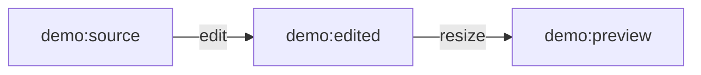

# Display a lineage snapshot as Mermaid

**Document class:** adapter/tooling example, non-normative

**Target:** ENTITY v3.4.3 `AssetProvenanceGraph.lineage()` output

**Requirements:** Python 3.11+ standard library; no network or credentials

`lineage_to_mermaid.py` displays the recorded parent/child relationships around one requested asset. Labels retain the supplied asset identifiers and relationship names. The example consumes the one-hop snapshot returned by [`AssetProvenanceGraph.lineage()` in v3.4.3](https://github.com/blackmore-technology-group/ENTITY/blob/v3.4.3/src/04_Entity_Registry/provenance/canonical_provenance.py); it does not traverse a database or fetch additional ancestry.

From the repository root:

```sh
python examples/lineage_to_mermaid.py examples/lineage_snapshot.json
python -m unittest tests.test_lineage_to_mermaid_example -v
```

The public `lineage_snapshot.json` fixture is a synthetic, minimal display projection: an edit of a source followed by a resized preview. All identifiers are fictional. Its output can be pasted inside a `mermaid` fence in GitHub Markdown:



## Display input profile

The top-level JSON object requires these fields:

| Field | Display requirement |
| --- | --- |
| `asset_id` | The requested asset identifier; 1–256 printable characters, including a non-space character. |
| `parents` | Array of objects with `parent_asset_id`, `child_asset_id` and `relation`; each child must equal the requested `asset_id`. |
| `children` | Array with the same three fields; each parent must equal the requested `asset_id`. |

Both endpoint identifiers and relation labels use the same character/length bound as `asset_id`. Identifiers remain case-sensitive and are not trimmed or otherwise normalised. Extra runtime fields, including bindings, evidence origins, timestamps and signatures, are not displayed or assessed. Relationship names are displayed as supplied; this tool does not validate their protocol semantics.

Input is bounded to 1 MiB of UTF-8 JSON (an optional UTF-8 BOM is accepted) and 128 relationship rows across both arrays. Duplicate JSON keys, non-standard JSON constants, missing fields, incorrect types, control characters and inconsistent parent/child placement produce a clear error on stderr, exit status 1 and no partial diagram. For a malformed example:

```sh
python examples/lineage_to_mermaid.py examples/lineage_snapshot_invalid.json
```

This command must exit non-zero because the parent relationship has no `child_asset_id`. Tests also exercise malformed JSON and the size/relationship limits.

Output is deterministic UTF-8 with LF line endings: nodes sort by the exact asset identifier and relationship rows sort by parent, child and relation. Input object/array order does not affect the diagram. Duplicate relationship rows and self-links are retained; drawing them makes no claim about graph validity. Internal `n0`-style Mermaid identifiers are assigned by that ordering, while visible labels retain the asset identifiers. Special label characters use [Mermaid entity codes](https://mermaid.js.org/syntax/flowchart.html#entity-codes-to-escape-characters), keeping supplied text out of diagram syntax.

## Evidence boundary

The diagram is a view of the supplied records. It neither verifies signatures/content hashes nor establishes that the requested asset exists: an isolated identifier with no binding or relationships is still displayed. It does not establish complete ancestry, authority, objective truth, legal ownership or economic entitlement. Rendering a snapshot does not upgrade any provenance claim.

This example changes no runtime schema, canonical identity rule, sealed vector, historical receipt or production state. It is not an ENTITY Protocol 1.0 conformance requirement. Only share snapshots whose identifiers and relationships are appropriate for public display.
